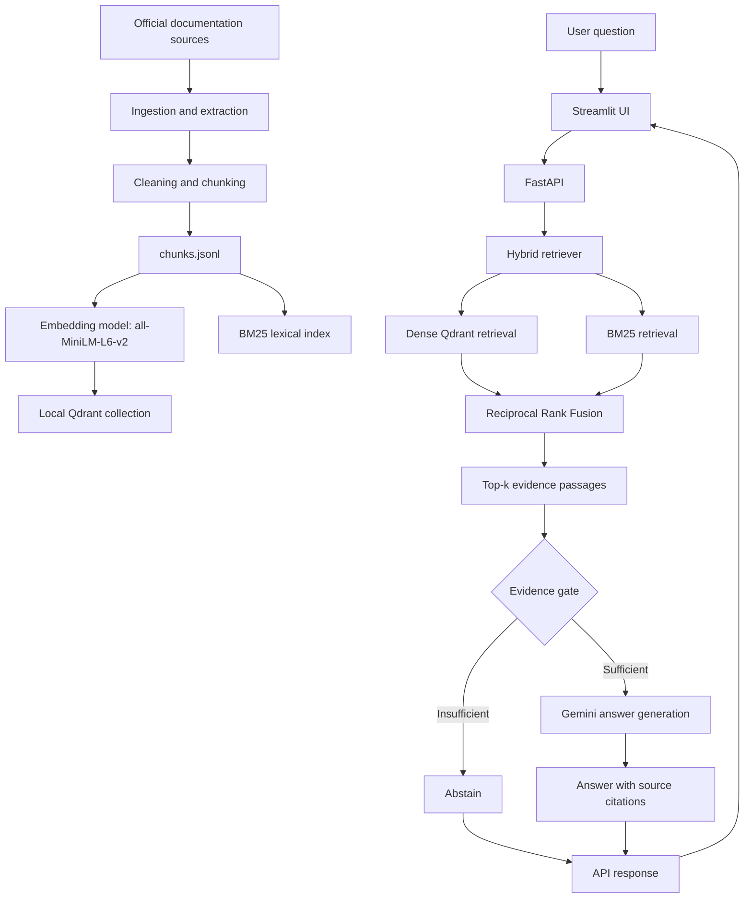

# Engineering Knowledge Intelligence Platform

A retrieval-augmented generation (RAG) application for answering engineering troubleshooting questions from a curated set of official technical documentation. It combines dense semantic retrieval with BM25 keyword retrieval, merges rankings using Reciprocal Rank Fusion (RRF), checks whether retrieved evidence is sufficient, and either abstains or generates an answer with source citations.

> **Project scope:** the current index covers Python exceptions, SQLAlchemy errors and connection pools, and PostgreSQL connection configuration. This is a focused portfolio project, not a general-purpose documentation assistant.

## Features

- **Documentation ingestion:** fetches selected official documentation pages, extracts and normalizes content, splits it into chunks, and writes JSONL records.
- **Hybrid retrieval:** combines local sentence-transformer embeddings and Qdrant vector search with BM25 lexical retrieval using RRF.
- **Evidence sufficiency gate:** rejects questions when retrieved evidence does not meet the configured threshold.
- **Cited answer generation:** uses LangChain's Google GenAI integration to generate answers grounded in retrieved passages.
- **API and UI:** FastAPI exposes health and question endpoints; Streamlit provides a user-facing interface.
- **Evaluation tools:** includes retrieval benchmarks, reranker comparisons, evidence-gate and answer evaluation, review utilities, and pytest tests.

## Architecture



## Main components

| Component | Location | Responsibility |
|---|---|---|
| Documentation ingestion | `scripts/ingest_docs.py` | Downloads, extracts, cleans, chunks, and writes source documentation to `data/processed/chunks.jsonl`. |
| Vector indexing | `app/ingestion/index_qdrant.py` | Embeds chunks and persists them in the local Qdrant collection `engineering_docs_v1`. |
| Hybrid retrieval | `app/retrieval/hybrid_retriever.py` | Dense retrieval, BM25 retrieval, and RRF rank fusion. |
| Evidence gate | `app/retrieval/evidence_gate.py` | Determines whether retrieved evidence is sufficient to proceed to generation. |
| Answer generation | `app/generation/answer_generator.py` | Calls Gemini through LangChain and handles answer/citation output. |
| RAG orchestration | `app/rag_pipeline.py` | Connects retrieval, evidence assessment, and answer generation. |
| API | `app/api/main.py` | FastAPI endpoints. |
| UI | `app/ui/streamlit_app.py` | Streamlit question-and-answer interface. |
| Evaluation runner | `app/run_answer_evaluation.py` | Runs answer evaluation in dry-run, retrieval-only, or generation mode. |

## Technology stack

- **Language:** Python 3.12.5
- **Retrieval:** `sentence-transformers/all-MiniLM-L6-v2`, Qdrant local storage, `rank-bm25`, Reciprocal Rank Fusion
- **LLM integration:** LangChain Google GenAI integration with Gemini
- **Backend:** FastAPI, Pydantic, Uvicorn
- **Frontend:** Streamlit
- **Ingestion:** Requests, Beautiful Soup, LangChain text splitters
- **Testing:** pytest, HTTPX

The embedding model runs locally on CPU in the current implementation. Gemini is used for answer generation and requires an API key. The first index build may download model files and requires internet access.

## Documentation sources

- [Python exceptions](https://docs.python.org/3/library/exceptions.html)
- [SQLAlchemy errors](https://docs.sqlalchemy.org/en/20/errors.html)
- [PostgreSQL libpq connection parameters](https://www.postgresql.org/docs/current/libpq-connect.html)

## Setup (Windows PowerShell)

The project was tested with Python 3.12.5. From the repository root:

```powershell
python -m venv .venv
.\.venv\Scripts\Activate.ps1
python -m pip install --upgrade pip
pip install -r requirements.txt
```

If PowerShell prevents activation, run the environment's Python directly with `\.venv\Scripts\python.exe`.

Create your local `.env` from the example template:

```powershell
Copy-Item .env.example .env
notepad .env
```

Set `GOOGLE_API_KEY` to your Gemini API key. The code also accepts `GEMINI_API_KEY` as an alternative. Do not commit `.env` or expose keys in logs, screenshots, or issue reports. A valid key is required for generated answers, but not for ingestion, local indexing, or retrieval-only evaluation.

## Build the local knowledge index

Run from the project root with the virtual environment active:

```powershell
python scripts/ingest_docs.py
python app\ingestion\index_qdrant.py
```

The ingestion script creates `data/processed/chunks.jsonl`. The indexing script embeds those chunks and stores the vector collection under `data/qdrant/`, using collection name `engineering_docs_v1` and 384-dimensional cosine vectors. BM25 also reads the chunk JSONL file, so the chunks and Qdrant index must come from the same ingestion run.

The development index used for the recorded evaluation contained **335 chunks across 201 extracted sections**. Counts can change when source documentation or extraction/chunking logic changes.

## Run the application

### 1. Start the API

In terminal 1, from the project root:

```powershell
.\.venv\Scripts\Activate.ps1
uvicorn api.main:app --app-dir app --reload
```

The interactive API schema is available at `http://127.0.0.1:8000/docs`. Check the service with:

```powershell
Invoke-RestMethod http://127.0.0.1:8000/health
```

### 2. Start the Streamlit interface

In terminal 2:

```powershell
.\.venv\Scripts\Activate.ps1
streamlit run app/ui/streamlit_app.py
```

The UI defaults to the API at `http://127.0.0.1:8000`. Set `RAG_API_URL` in the Streamlit environment to use a different API URL.

### 3. Run tests

```powershell
python -m compileall -q app scripts tests
python -m pytest tests -q
```

The latest local regression run passed **20 tests**. Results may change as code and dependency versions change.

## Development evaluation (pilot v2)

The current development evaluation contains **28 answer-evaluation questions**: 21 answerable questions and 7 questions intended to trigger abstention. The retrieval benchmark contains 21 answerable queries. Held-out evaluation data is intentionally not included in this repository and must not be used for development tuning.

### Retrieval benchmark

The development relevance-label file contains 346 query-candidate judgments across 21 queries: 66 labeled relevant and 280 labeled irrelevant. The labels were AI-assisted and have not been independently human-verified. The following metrics are therefore preliminary. Recall is pool-based: its denominator is the relevant material in the judged candidate pool, not every relevant passage in the full corpus. nDCG uses binary relevance labels.

| Retriever | Recall@5 | Recall@10 | MRR | nDCG@5 | nDCG@10 |
|---|---:|---:|---:|---:|---:|
| Dense | 0.7899 | 0.8913 | 0.8349 | 0.7499 | 0.7747 |
| BM25 | 0.7849 | 0.8988 | 0.8746 | 0.8120 | 0.8285 |
| **Hybrid (selected baseline)** | **0.8813** | **0.9845** | **0.9206** | **0.8827** | **0.9085** |

Hybrid retrieval led across all five reported metrics in this development candidate pool. These figures should be rechecked after independent relevance-label review.

### Reranker comparison

The cross-encoder reranker was evaluated on the hybrid top-10 results:

| Metric | Hybrid top-10 | Hybrid + reranker |
|---|---:|---:|
| Recall@5 | 0.8906 | 0.7636 |
| MRR | 0.9206 | 0.9180 |
| nDCG@5 | 0.8827 | 0.8172 |
| nDCG@10 | 0.9157 | 0.8953 |

The reranker reduced recall and nDCG and did not improve MRR in this run. It is therefore not part of the selected retrieval baseline.

### Evidence gate and answer review

At the recorded dense-similarity threshold of **0.47**, retrieval-only evaluation accepted all 21 answerable development questions and rejected all 7 out-of-scope questions. This is an observation on a small curated dataset, not a guarantee for unseen questions.

The 28-question development answer run produced 21 answers and 7 abstentions. The first-pass answer review reported:

| Metric | Result | Qualification |
|---|---:|---|
| Expected-fact coverage | 38/42 (90.5%) | Provisional review labels |
| Factual correctness | 42/42 (100%) | Not independently human-validated |
| Citation support | 41/42 (97.6%) | Not independently human-validated |
| Abstention agreement | 28/28 | On the development set |

These review labels were initially assistant-generated and should be treated as provisional until a human verifies expected facts and claim-to-source support. Citation-ID validation checks citation structure/status; it does not by itself prove that a citation entails a claim.

### Performance snapshot

For the recorded development answer-evaluation run, retrieval latency was **143.3 ms median** and **142.1 ms mean** across 28 questions. Generation latency for 21 answerable questions was **4.26 s median** and **6.29 s mean**. Mean token use was approximately **1,943 tokens per generated answer**. These are single-run observations, not latency guarantees.

Detailed tables and per-query outputs are in `results/pilot_v2/`. See [the evaluation notes](docs/retrieval_evaluation.md) for methodology and limitations.

## Repository layout

```text
app/
  api/                 FastAPI application
  generation/          Answer generation and review utilities
  ingestion/           Qdrant indexing
  retrieval/           Dense, BM25, RRF, evidence gate, and retrieval evaluation
  ui/                  Streamlit interface
  rag_pipeline.py       RAG orchestration
  run_answer_evaluation.py
scripts/                Ingestion, audits, and experiment utilities
tests/                  Automated test suite
evaluation/             Development datasets and review files
docs/                   Architecture and evaluation documentation
results/pilot_v2/        Selected development evaluation artifacts
```

Generated `data/`, local vector-store files, held-out datasets, historical experiment runs, virtual environments, and secrets are excluded by `.gitignore`. Selected pilot v2 development results are included so the reported experiments can be inspected.

## Limitations and next steps

- The indexed corpus covers only three documentation areas; unsupported topics are expected to trigger abstention.
- The benchmark is small and curated. Broader query coverage is needed before drawing general conclusions.
- Retrieval relevance labels and answer-review scores require independent human validation.
- The evidence gate uses a fixed dense-similarity threshold; its behavior should be tested on more varied in-scope and out-of-scope questions.
- The reranker did not improve the current benchmark results and is not selected as part of the baseline.
- Repeated latency runs are needed to understand performance variance.

## License and source attribution

No project license has been added yet. The indexed documentation sources are linked above; consult their respective terms. Add an explicit license before presenting this repository as open source.
